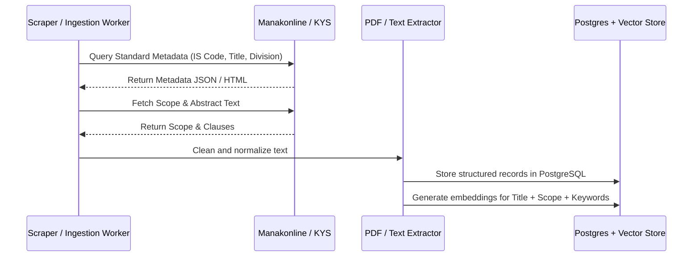

# 02. BIS Standards Dataset & Taxonomy Architecture

## 1. BIS Division Councils (Taxonomy)

The Bureau of Indian Standards (BIS) formulates standards across **14 Technical Division Councils**. Each council covers specialized technical sectors and manages several Sectional Committees:

| Division Code | Division Council Name | Examples of Governed Items |
| :--- | :--- | :--- |
| **CED** | Civil Engineering Division | Cements, bricks, steel rebars, doors/windows, pipes, sanitary fixtures |
| **ETD** | Electrotechnical Division | Transformers, switchgears, cables, domestic appliances, electric motors |
| **LITD** | Electronics & Information Technology | Mobile phones, computers, power banks, displays, IT security |
| **MED** | Mechanical Engineering Division | Pumps, diesel engines, compressors, boilers, refrigeration machinery |
| **MTD** | Metallurgical Engineering Division | Structural steel, aluminum alloys, copper rods, welding consumables |
| **CHD** | Chemical Division | Paints, varnishes, soaps, industrial chemicals, fertilizers |
| **PCD** | Petroleum, Coal & Related Products | Lubricating oils, bitumens, petrochemicals, fuels, polymers |
| **FAD** | Food and Agriculture Division | Grains, milk products, processed foods, infant nutrition, fertilizers |
| **TXD** | Textile Division | Polypropylene geotextiles, cotton yarns, protective garments, jute bags |
| **TED** | Transport Engineering Division | Automotive components, helmets, railway wagons, bicycles |
| **MHD** | Medical Equipment & Hospital Planning | Surgical instruments, diagnostic imaging, disposable syringes, PPE |
| **WRD** | Water Resources Division | Canals, dams, flow meters, spillways, barrages |
| **PGD** | Production & General Engineering | Fasteners, bearings, machine tools, hand tools |
| **MSD** | Management & Systems Division | Quality management (ISO 9001), Environmental management |

---

## 2. Standard Life-Cycle & State Machine

Every Indian Standard undergoes continuous revision. Tracking its operational status is vital to prevent procurement of goods under obsolete requirements:

```
[Preliminary Draft] 
       │
       ▼
 [Wide Circulation] 
       │
       ▼
  [Published] ◄────────────────────────────────────────┐
       │                                               │
       ├──► [Periodic Review (Every 5 Years)] ─────────┤
       │         │                                     │
       │         ├──► [Reaffirmed] ────────────────────┘
       │         │
       │         └──► [Under Revision] ──► [Superseded by New IS]
       │
       └──► [Amendments Issued (Slips 1, 2, ...)]
       │
       └──► [Withdrawn]
```

### Key Life-Cycle Attributes
1. **Active / Current:** Legally valid for specification.
2. **Reaffirmed:** Standard reviewed and found valid without technical change (e.g., `IS 1786:2008 (Reaffirmed 2018)`).
3. **Superseded:** Replaced by a newer version or completely new standard code. Tenders citing superseded standards must trigger automated warnings.
4. **Withdrawn:** Standard abolished without direct replacement.

---

## 3. Data Ingestion & Harvesting Strategy

### 3.1 Data Sources
1. **BIS "Know Your Standard" (KYS) Portal (`manakonline.in`):**
   * Contains metadata: Standard Number, Title, Scope, Committee, Number of Amendments, Gazette notification dates.
2. **BIS Compulsory Certification Scheme List (QCO Portal):**
   * Central registry of all products under mandatory ISI certification.
3. **Public Technical Datasets:**
   * BIS Gazette notifications, e-Sale portal, open-access standard abstracts, and Open Government Data (OGD) platform (`data.gov.in`).

### 3.2 Harvesting Workflow


---

## 4. Database Schema Design (PostgreSQL + pgvector)

```sql
-- 1. Division Councils Table
CREATE TABLE division_councils (
    division_code VARCHAR(10) PRIMARY KEY, -- e.g., 'CED', 'ETD'
    name VARCHAR(255) NOT NULL,
    description TEXT
);

-- 2. Indian Standards Master Table
CREATE TABLE indian_standards (
    id UUID PRIMARY KEY DEFAULT gen_random_uuid(),
    is_number VARCHAR(50) NOT NULL UNIQUE,      -- e.g., 'IS 1786'
    part_section VARCHAR(50),                   -- e.g., 'Part 1'
    publication_year INT NOT NULL,              -- e.g., 2008
    reaffirmed_year INT,                        -- e.g., 2018
    title VARCHAR(500) NOT NULL,
    division_code VARCHAR(10) REFERENCES division_councils(division_code),
    scope TEXT NOT NULL,
    abstract TEXT,
    status VARCHAR(20) NOT NULL DEFAULT 'ACTIVE', -- ACTIVE, SUPERSEDED, WITHDRAWN
    superseded_by_is VARCHAR(50),
    is_mandatory_qco BOOLEAN DEFAULT FALSE,
    qco_ministry VARCHAR(255),
    qco_notification_date DATE,
    keywords TEXT[],
    created_at TIMESTAMP WITH TIME ZONE DEFAULT NOW(),
    updated_at TIMESTAMP WITH TIME ZONE DEFAULT NOW()
);

-- 3. Standard Key Clauses & Parameters Table
CREATE TABLE standard_parameters (
    id UUID PRIMARY KEY DEFAULT gen_random_uuid(),
    standard_id UUID REFERENCES indian_standards(id) ON DELETE CASCADE,
    clause_number VARCHAR(20),                 -- e.g., 'Clause 4.2'
    clause_title VARCHAR(255),                 -- e.g., 'Tensile Properties'
    parameter_name VARCHAR(100),               -- e.g., 'Yield Stress'
    parameter_value_min NUMERIC,
    parameter_value_max NUMERIC,
    unit VARCHAR(30),                          -- e.g., 'MPa'
    description TEXT
);

-- 4. Vector Embeddings Table (pgvector)
CREATE EXTENSION IF NOT EXISTS vector;

CREATE TABLE standard_embeddings (
    standard_id UUID PRIMARY KEY REFERENCES indian_standards(id) ON DELETE CASCADE,
    embedding vector(768),                     -- Compatible with BGE-base or MiniLM
    searchable_text TEXT NOT NULL,             -- Combined Title + Scope + Keywords
    updated_at TIMESTAMP WITH TIME ZONE DEFAULT NOW()
);

-- 5. Full-Text Search (BM25 Inverted Index emulation in Postgres)
CREATE INDEX idx_standards_fts ON indian_standards 
USING GIN (to_tsvector('english', is_number || ' ' || title || ' ' || scope));
```

---

## 5. Seed Dataset Strategy for Hackathon MVP

For an SIH hackathon prototype, rather than attempting to ingest all 20,000+ standards (which can be rate-limited or paywalled), we target a **high-impact, diverse seed dataset of 1,000 top procurement standards**:

1. **Top Civil & Construction:** *IS 456 (Concrete), IS 1786 (Rebars), IS 269 / 1489 (Cement), IS 1239 (Mild Steel Tubes), IS 2062 (Structural Steel), IS 1077 (Burnt Clay Bricks).*
2. **Top Electrical & Electronics:** *IS 694 (PVC Cables), IS 1293 (Plugs and Sockets), IS 3043 (Earthing), IS 16046 (Secondary Lithium Cells), IS 9873 (Safety of Electronics).*
3. **Top Mechanical & Safety Equipment:** *IS 2925 (Industrial Helmets), IS 9473 (Respiratory Masks), IS 1520 (Centrifugal Pumps), IS 1989 (Leather Safety Footwear).*
4. **Top Food & Consumables:** *IS 11536 (Infant Milk Foods), IS 14433 (Infant Formulae), IS 14543 (Packaged Drinking Water).*
5. **Top Chemical & Medical:** *IS 5607 (Liquid Hand Wash), IS 1061 (Disinfectant Fluids), IS 13422 (Surgical Face Masks).*

This curated distribution ensures our demo effectively handles real tenders from any government department.
