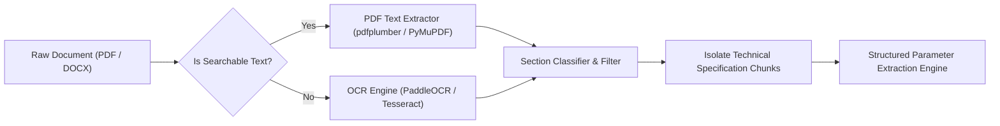

# 03. NLP & Parameter Extraction Pipeline

## 1. Structure of Procurement Tender Documents

Tender documents issued in Indian public procurement (CPPP, GeM, Railways, Defense, CPWD) typically range from 15 to 150 pages. However, only specific sections contain technical requirements:

```
Tender Document (RFP / NIT)
 ├── Section 1: Invitation for Bids (IFB) [Administrative]
 ├── Section 2: Instructions to Bidders (ITB) [Administrative]
 ├── Section 3: General Conditions of Contract (GCC) [Legal]
 ├── Section 4: Special Conditions of Contract (SCC) [Legal / Commercial]
 ├── Section 5: Technical Specification Schedule (TSS) ◄── [CORE TARGET]
 ├── Section 6: Bill of Quantities (BOQ) / Price Schedule ◄── [CORE TARGET]
 └── Section 7: Buyer-Added Additional Terms & Conditions (ATC) ◄── [CORE TARGET]
```

### Document Parsing Challenges
1. **Multi-Column & Tabular Layouts:** Technical specs often reside in dense comparison tables with merged headers.
2. **Scanned Documents:** Certain state PSUs still scan paper notices, requiring an Optical Character Recognition (OCR) pipeline.
3. **Boilerplate Noise:** Over 80% of a tender consists of standard clauses (penalties, arbitration, payment terms) that must be filtered out before parameter extraction.

---

## 2. Ingestion & Preprocessing Pipeline



### Filtering Pipeline
1. **Section Header Detection:** Regex + keyword heuristics to locate headings like:
   * `Technical Specifications`, `Schedule of Requirements`, `Scope of Work`, `Technical Compliance Sheet`.
2. **Noise Reduction:** Strip headers, footers, pagination, and legal boilerplate (e.g., "Liquidated Damages", "Earnest Money Deposit").

---

## 3. Technical Parameter Extraction Ontology

To perform accurate semantic matching against BIS standards, unstructured tender descriptions must be transformed into a standardized JSON schema:

```json
{
  "item_category": "High Strength Deformed Steel Bars",
  "intended_application": "Concrete reinforcement in RCC structural members",
  "material_grade": "Fe 500D",
  "physical_dimensions": {
    "nominal_diameter_mm": [8, 10, 12, 16, 20, 25, 32],
    "length_meters": 12.0,
    "tolerance_percent": 0.5
  },
  "mechanical_properties": {
    "yield_stress_min_mpa": 500.0,
    "tensile_strength_min_mpa": 565.0,
    "elongation_min_percent": 16.0
  },
  "testing_requirements": [
    "Bend and Rebend Test",
    "Chemical Composition Analysis (Carbon, Sulphur, Phosphorus max limits)"
  ],
  "environmental_or_special_coatings": "Epoxy coated / Non-corrosive"
}
```

### Parameter Categories Extracted
1. **Commodity / Primary Object:** Core noun phrase (`Centrifugal Water Pump`, `PVC Insulated Cable`).
2. **Material Composition & Grade:** Metallurgy, plastics, chemical purity (`Fe 500D`, `Grade 43`, `SS 316`).
3. **Physical & Geometric Constraints:** Dimensions, thickness, tolerances, cross-sectional area.
4. **Operational & Performance Ratings:** Pressure ratings (bar/psi), voltages (kV), flow rate ($m^3/hr$), thermal limits.
5. **Testing & Inspection Standards:** Required tests (hydrostatic, insulation resistance, tensile rupture).

---

## 4. Extraction Engine Implementation Options

### Approach A: Pydantic-Enforced Structured Extraction (Recommended)
Using modern open LLMs or API-based models with instructor/Pydantic validation:
* **Mechanism:** Feed the isolated technical section chunk into the LLM with a strict JSON schema.
* **Benefits:** Guarantees typed outputs, handles synonymous phrasing, normalizes units (e.g., converts $N/mm^2$ to $MPa$).
* **Reliability:** Built-in retry loops if validation fails.

```python
from pydantic import BaseModel, Field
from typing import List, Optional

class PhysicalDimension(BaseModel):
    parameter_name: str
    nominal_value: Optional[float]
    unit: Optional[str]
    tolerance: Optional[str]

class TechnicalSpecification(BaseModel):
    commodity_name: str = Field(description="Generic item name")
    material_grade: Optional[str] = Field(description="Grade or composition")
    dimensions: List[PhysicalDimension] = Field(default_factory=list)
    performance_ratings: List[str] = Field(default_factory=list)
    tests_required: List[str] = Field(default_factory=list)
    detected_brand_names: List[str] = Field(description="Any specific brands or model numbers mentioned")
```

### Approach B: Hybrid Rule-Based / Regex Pattern Matcher (Fallback & Speedup)
* High-speed tokenization using regex for standard Indian Standard patterns:
  * Pattern: `r'\bIS\s*(?:[:\s-]?\s*)(\d{3,5})(?:\s*(?:Part|Pt)[\s\.]*(\d+))?(?:\s*[:\s-]?\s*(\d{4}))?\b'`
  * Captures citations like: `IS 1786`, `IS 1239 (Part 1): 2004`, `IS:456-2000`.
* Unit extraction parser (using `pint` or `regex`) to extract values like `500 MPa`, `1100 V`, `16 sq.mm`.

---

## 5. Performance Evaluation & Validation Metrics

To validate the extraction engine:
* **Precision:** Percentage of extracted technical parameters that truly represent legitimate tender requirements (target $> 92\%$).
* **Recall:** Percentage of critical specifications in the tender successfully captured (target $> 95\%$).
* **Latency:** Ingestion and extraction must execute under 5 seconds for a standard 10-page specification schedule.
