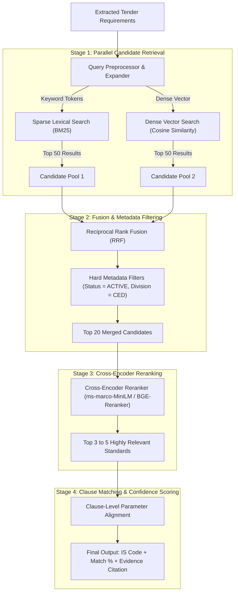

# 04. Hybrid Retrieval & Recommendation Engine

## 1. Why Naive Vector Search Fails for Technical Standards

Standard Retrieval-Augmented Generation (RAG) relies on pure cosine similarity over dense vector embeddings. In technical standard recommendation, this leads to critical failure modes:

| Failure Mode | Example Scenario | Why Pure Vector Search Fails |
| :--- | :--- | :--- |
| **Alphanumeric Code Inability** | Tender mentions *"IS 1786 Grade Fe 500"* | Embeddings treat numbers fuzzily; may retrieve `IS 1785` (Prestressing steel) due to vector proximity. |
| **Exact Dimension & Rating Mismatch** | Tender specifies *"1100V rated PVC cable"* | Semantic search matches general "cables", but misses the strict voltage boundary defined between `IS 694` (up to 1100V) and `IS 1554` (heavy duty). |
| **Vocabulary Gap** | Tender asks for *"Sariya for foundation pillar"* | BIS Standard title is *"High strength deformed steel bars and wires for concrete reinforcement"*. Keyword search fails entirely without semantic expansion. |

### The Solution: Multi-Stage Hybrid Search Pipeline
Combining **Sparse Lexical Search (BM25)**, **Dense Semantic Embeddings**, and a **Cross-Encoder Reranker** provides optimal precision and recall.

---

## 2. Multi-Stage Retrieval Architecture



---

## 3. Detailed Algorithmic Steps

### Step 1: Query Preprocessing & Expansion
The extracted parameters from the tender are formatted into two complementary query representations:
1. **Lexical Query (for BM25):** Emphasizes technical keywords, material grades, and known IS codes.
   * *Example:* `"IS 1786" OR "Fe 500D" OR "steel bar" OR "reinforcement" OR "concrete"`
2. **Semantic Query (for Dense Embedding):** A natural descriptive sentence emphasizing functional purpose.
   * *Example:* `"High strength steel rebar Fe 500D with 500 MPa yield strength for structural concrete reinforcement."`

### Step 2: Reciprocal Rank Fusion (RRF)
To merge results from BM25 and vector search without requiring score normalization:
$$RRF\_Score(d \in D) = \sum_{m \in M} \frac{1}{k + r_m(d)}$$
Where:
* $M$: Set of retrieval systems ($\{\text{BM25}, \text{Dense}\}$).
* $r_m(d)$: Rank of document $d$ in system $m$.
* $k$: Smoothing constant (typically $k = 60$).

### Step 3: Cross-Encoder Reranking
Bi-encoder embeddings compute representations of query and document independently, losing fine-grained interaction.  
The **Cross-Encoder** ingests the query and candidate standard text simultaneously through cross-attention:
$$\text{Input} = [\text{CLS}] \; \text{Tender Parameters} \; [\text{SEP}] \; \text{Standard Scope \& Clause} \; [\text{EOS}]$$
This allows the neural network to evaluate exact technical compatibility (e.g., verifying if the standard's tensile range encompasses the tender's requirement).

---

## 4. Confidence Calibration & Clause-Level Explainability

Procurement officers require audit justification. The system calculates confidence based on three weighted factors:

$$\text{Confidence Score} = w_1 \cdot S_{\text{semantic}} + w_2 \cdot S_{\text{lexical}} + w_3 \cdot S_{\text{parameter\_match}}$$
* $w_1 = 0.40$: Cross-encoder semantic relevance score.
* $w_2 = 0.25$: Direct keyword/grade overlap score.
* $w_3 = 0.35$: Parameter range compliance (e.g., does the standard specify $500 \text{ MPa}$ minimum yield stress?).

### Example Output Card Presented to User:
```
Recommended Standard: IS 1786 : 2008 (Reaffirmed 2018)
Title: High Strength Deformed Steel Bars and Wires for Concrete Reinforcement
Confidence Score: 94.2% [HIGH MATCH]
Status: ACTIVE (Supersedes IS 1139)
Mandatory QCO: YES (Ministry of Steel Order 2018 - ISI Mark Mandatory)

Evidence & Clause Alignment:
• Clause 4.2 (Grades): Explicitly governs Grade Fe 500D requested in tender.
• Table 3 (Mechanical Properties): Specifies min. 0.2% proof stress = 500.0 MPa (Matches tender requirement: 500 MPa).
• Clause 8.1 (Sizes): Covers 8mm to 32mm nominal diameters requested.
```
