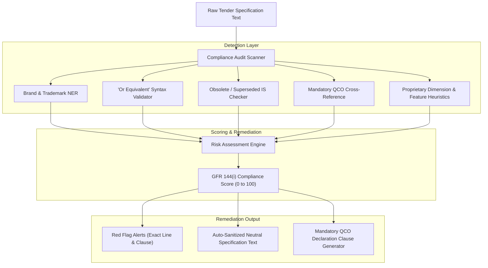

# 05. Anti-Bias & GFR 144(i) Compliance Engine

## 1. The Core Threat: Procurement Bias & Restrictive Tenders

Under the **General Financial Rules (GFR 2017) Rule 144(i)**, government tenders must maintain commercial neutrality. In practice, public procurement is frequently subject to **restrictive tailoring**—either intentionally by corrupt officials or unintentionally by officers copying vendor brochures.

This engine functions as an automated **Integrity & Compliance Sentinel** that scans every uploaded tender specification.

---

## 2. Taxonomy of Procurement Bias

| Bias Category | Mechanism | Example in Tender | GFR Violation |
| :--- | :--- | :--- | :--- |
| **Direct Brand Leakage** | Explicitly naming a manufacturer or trademark | *"Procurement of 500 units of Tata Tiscon 500D bars"* | Violates Rule 144(i)(b) |
| **Missing Equivalence Clause** | Naming a proprietary benchmark without 'or equivalent' | *"Processor must be Intel Core i7 13700"* | Violates Rule 144(i)(b) (Excludes AMD) |
| **Proprietary Feature Lock-in** | Mandating a patented or single-vendor feature | *"Switch must support Cisco Smart Licensing and IOS-XE"* | Tailoring tender to single vendor |
| **Artificial Dimensional Narrowing** | Specifying arbitrary tolerances that exclude competing OEMs | *"Laptop dimensions: Exactly 312.4mm x 221.1mm x 15.9mm; Weight: 1.29 kg"* | Restrictive parameter tailoring |
| **Foreign Standard Preference** | Citing foreign standards when valid Indian Standards exist | *"Pipes must conform to ASTM A53 Grade B"* | Violates Rule 144(i)(d) (IS 1239 exists) |
| **Obsolete Standard Citation** | Referencing withdrawn or superseded standards | *"Cement conforming to IS 269:1989 (33 Grade)"* | Risk of sub-standard/non-certified delivery |

---

## 3. Anti-Bias Detection Architecture



---

## 4. Detection Methodologies

### 4.1 Brand & Trademark Named Entity Recognition (NER)
* **Gazetteer Matching:** High-speed lookup against a dictionary of 10,000+ registered commercial brands across GeM product categories (e.g., *Dell, HP, Lenovo, Cisco, Tata, Jindal, UltraTech, Havells, Schneider, Bosch*).
* **Contextual NER:** Transformer-based entity recognizer to detect newly emerging trademarks and proprietary trade names.

### 4.2 Syntax Validation ("Or Equivalent")
* If a trade name or proprietary specification is detected, the regex parser examines the trailing 10 tokens:
  $$\text{Regex Pattern:} \quad \text{r'\\b(?:or\\s+equivalent|or\\s+higher|or\\s+better)\\b'}$$
* If absent, a **HIGH SEVERITY GFR 144(i) VIOLATION** is flagged.

### 4.3 Superseded Standard Interceptor
* Compares any detected `IS <number>` pattern against the BIS Master Lifecycle state table:
  * If `status == 'SUPERSEDED'`:
    * Generates alert: *"IS 269:1989 is superseded by IS 269:2015. Please update the specification to avoid legal contestation by suppliers."*
  * If `status == 'WITHDRAWN'`:
    * Generates alert: *"IS XXXX has been withdrawn by BIS without direct equivalent. Refer to recommended alternative."*

### 4.4 Mandatory QCO Verification Gate
* Looks up the recommended/identified standard in the notified QCO registry.
* If a QCO is in force:
  * Generates required tender clause:
    > *"In compliance with the Quality Control Order issued by the Ministry of Steel / DPIIT under Section 16 of the BIS Act 2016, all offered goods must bear the valid BIS Standard Mark (ISI mark) and the bidder must furnish a valid BIS license certificate with their technical bid."*

---

## 5. Auto-Sanitization & Remediation Engine

A key differentiator for our solution is that it doesn't just critique the tender—it **automatically rewrites it into compliant, generic language**:

```json
{
  "detected_violation": {
    "original_text": "Supply of Havells or Finolex 2.5 sq.mm FR PVC insulated copper wire conforming to IS 694.",
    "violation_type": "BRAND_NAME_BIAS",
    "gfr_clause": "Rule 144(i)(b)",
    "severity": "CRITICAL",
    "suggested_sanitized_text": "Supply of 2.5 sq.mm Flame Retardant (FR) PVC insulated plain copper conductor wire conforming to IS 694:2010 with valid ISI mark (or equivalent conforming to IS 694)."
  }
}
```
